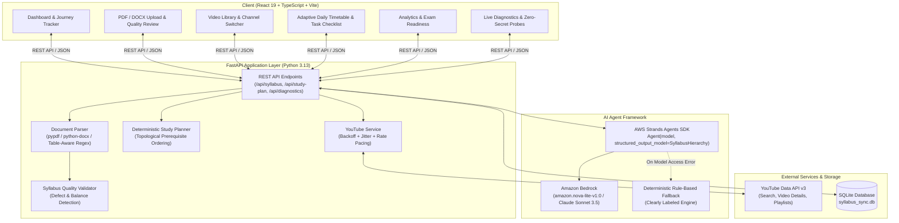

# SyllabusSync AI 🎓⚡

> **Intelligent Course Roadmap & Adaptive Video Study Assistant**  
> *Built with AWS Strands Agents SDK, Amazon Bedrock, YouTube Data API v3, FastAPI, SQLite, and React 19.*

Turn dense, complex university course syllabi into an actionable, daily study schedule powered by structured AI topic extraction, real educational YouTube video lectures, prerequisite-aware timetable generation, and adaptive rescheduling.

---

## 1. System Architecture



---

## 2. Key Features & Student Journey

1. **Document Ingestion & Validation:** Accepts university syllabi in `.pdf` and `.docx` format up to 10 MB. Detects blank/scanned documents without OCR hallucinations.
2. **AI-Powered Structured Analysis:** Extracts course code, course title, credit structure, semester, discrete modules, learning topics, and study durations.
3. **Table-Aware Extraction Intelligence:** Accurately parses complex university syllabi (e.g. VIT / Anna University CSE3016 format), extracting 7 distinct modules with declared teaching hours totaling 45.0 hours (2,700 minutes) while eliminating assignment instructions (`(A1)`, `(A2)`, `Assignment to be given`, `Tools to be used`).
4. **Structural Quality Validation:** Evaluates syllabus structure against university standards. Detects unbalanced delivery hours, empty modules, topic fragments, and metadata leakage.
5. **Interactive Topic Review:** Allows students to edit titles, reorder modules, add custom topics, adjust estimated minutes, and persist changes directly to SQLite.
6. **YouTube Learning Discovery:** Discovers real educational videos matching topics via YouTube Data API v3 with ISO 8601 duration parsing.
7. **Channel Consistency Policy:** Employs a strict 1-primary or 2-complementary channel policy to avoid student cognitive overload; requires explicit student confirmation before introducing a 3rd channel.
8. **Topic-Specific Channel Replacement:** Enables students to swap channels for specific topics or exclude disliked instructors while maintaining channel persistence across roadmap updates.
9. **Prerequisite-Aware Timetable:** Generates a topological daily study roadmap respecting module dependencies, student study availability, and exam deadlines.
10. **Adaptive Recovery & Rescheduling:** Automatically moves incomplete tasks forward when study days are missed without disrupting downstream prerequisite dependencies.
11. **Task Tracking & Study Notes:** Students mark daily tasks as complete, add timestamped markdown study notes, and track progress towards exam readiness.
12. **Live Zero-Secret System Diagnostics:** Settings page features real-time probes for backend health, database connection, Amazon Bedrock IAM invocation, and YouTube Data API v3 without leaking credentials to the client.

---

## 3. AWS Strands Agents SDK & Amazon Bedrock

SyllabusSync AI uses the official **AWS Strands Agents SDK** (`strands-agents`) to orchestrate document analysis and structured hierarchy extraction.

### Live Strands Agent Invocations
```python
from strands import Agent
from app.schemas.syllabus import SyllabusHierarchy

# Initialize Strands Agent with Bedrock and Pydantic structured output
agent = Agent(
    model="amazon.nova-lite-v1:0",  # Or au.anthropic.claude-sonnet-5
    system_prompt=SYSTEM_PROMPT,
    structured_output_model=SyllabusHierarchy,
)

# Analyze syllabus with untrusted-data guardrails
result = agent(
    f"<UNTRUSTED_SYLLABUS_DOCUMENT>\n{raw_text}\n</UNTRUSTED_SYLLABUS_DOCUMENT>"
)
hierarchy: SyllabusHierarchy = result.structured_output
```

### Honest Bedrock Model Status
- **Amazon Nova Lite (`amazon.nova-lite-v1:0`) & Nova Pro (`amazon.nova-pro-v1:0`):** Verified active and operational in `ap-southeast-2` using the configured IAM credentials (`arn:aws:iam::162309817476:user/SyllabusSync-Dev`). No third-party use-case forms required.
- **Anthropic Claude Models (`au.anthropic.claude-sonnet-5`):** Require the AWS account owner to complete the one-time **Anthropic Use Case Details form** in the AWS Bedrock Console.
- **Error Classification & Safe Fallback:** When a Bedrock model lacks permissions or account enablement, the backend categorizes the error (`MODEL_NOT_AVAILABLE`, `AUTHORIZATION_FAILURE`, `CONFIG_MISSING`) and gracefully activates the deterministic university extractor with an explicit banner. LLM output is never faked.

---

## 4. YouTube API Reliability & Rate Limiting

The application integrates official YouTube Data API v3 search with production-grade reliability:

- **Exponential Backoff with Jitter:** Retries failed requests on HTTP 429 (Rate Limit) and HTTP 503 (Unavailable) using randomized backoff:
  $$\Delta t = 1.5^{\text{attempt}} + \text{jitter}(0.1, 0.4)$$
- **Non-Retryable Quota Detection:** Immediately captures HTTP 403 `quotaExceeded` / `dailyLimitExceeded` and switches to cached/curated fallback without wasting retries.
- **Polite Request Pacing:** Enforces an asynchronous pacing interval between sequential API calls to prevent burst rate limit tripping.
- **SQLite Search Cache:** Stores successful query responses with configurable TTL (default: 48 hours) to reduce API consumption.
- **Explicit Provenance Labels:** Every video in the library and database is tagged with its provenance (`live`, `cache`, or `fallback`).

---

## 5. Technology Stack

| Layer | Technology | Purpose |
| :--- | :--- | :--- |
| **Frontend** | React 19, TypeScript, Vite 8 | Dark navy/indigo responsive student portal |
| **Styling** | Tailwind CSS v4 | High-contrast EdTech aesthetics with custom scrollbars |
| **Backend** | Python 3.13, FastAPI, Uvicorn | Asynchronous REST API and services |
| **AI Framework** | **AWS Strands Agents SDK** | Multi-provider agent orchestration and structured output |
| **Cloud AI** | **Amazon Bedrock** | Amazon Nova Lite / Nova Pro / Anthropic Claude |
| **Video Discovery**| **YouTube Data API v3** | Real video search, durations, and channels |
| **Parsing** | `pypdf`, `python-docx` | Extraction from digital syllabi |
| **Database** | SQLite + SQLAlchemy core | ACID transactional persistence |
| **Testing** | `pytest`, `pytest-asyncio`, `httpx`| Comprehensive 49-test automated test suite |

---

## 6. Quick Start & Local Setup

### 6.1 Prerequisites
- Python 3.11+ (Python 3.13 tested)
- Node.js 18+ and npm
- Optional: AWS IAM Credentials with Bedrock access, and YouTube Data API v3 key.

### 6.2 Environment Configuration
Create `backend/.env` (see `backend/.env.example`):
```env
# Strands Agents SDK & Amazon Bedrock
STRANDS_PROVIDER=bedrock
STRANDS_MODEL=amazon.nova-lite-v1:0
AWS_ACCESS_KEY_ID=your_aws_access_key_id
AWS_SECRET_ACCESS_KEY=your_aws_secret_access_key
AWS_REGION=ap-southeast-2
ALLOW_DEV_FALLBACK_ANALYSIS=true

# YouTube Data API v3
YOUTUBE_API_KEY=your_google_youtube_api_key
YOUTUBE_MAX_SEARCH_RESULTS=5
YOUTUBE_CACHE_TTL_HOURS=48
ALLOW_DEV_FALLBACK_YOUTUBE=true
```

### 6.3 Backend Setup & Execution
```powershell
# Navigate to backend directory
cd backend

# Create and activate virtual environment
python -m venv .venv
.\.venv\Scripts\Activate.ps1

# Install dependencies
pip install -r requirements.txt

# Start FastAPI server
python -m uvicorn app.main:app --host 127.0.0.1 --port 8000 --reload
```
- API Base: `http://127.0.0.1:8000`
- Interactive Swagger Documentation: `http://127.0.0.1:8000/docs`

### 6.4 Frontend Setup & Execution
```powershell
# In a new terminal, navigate to frontend directory
cd frontend

# Install npm packages
npm install

# Start Vite development server
npm run dev
```
- Student Portal: `http://localhost:5173`

---

## 7. Verification & Automated Test Suite

### 7.1 Backend Test Execution (49/49 Passing)
```powershell
cd backend
.\.venv\Scripts\pytest backend/tests/ -v
```

**Test Coverage Summary:**
- `test_cse3016_extraction.py` (7 tests): University table parsing, 7 modules, 45.0 hrs consistency, zero assignment leakage, line unwrapping, Bedrock error classification.
- `test_phase5_intelligence.py` (7 tests): CS 305 linear syllabus extraction, validation engine defect detection, topological sorting, zero-secret diagnostics, YouTube provenance labeling.
- `test_study_planner.py` (7 tests): Feasible study plan generation, shortfall alerts, task toggle, progress recalculation, task notes persistence, adaptive reschedule.
- `test_youtube_resources.py` (10 tests): ISO 8601 parsing, HTTP mocking, quota backoff, deduplication, 1-channel policy, 2-channel balance, 3-channel approval, single-topic replacement.
- `test_syllabus_analysis.py` (11 tests): Strands Agent execution, structured output validation, JSON recovery, CRUD updates, 503 missing credentials handling.
- `test_syllabus_upload.py` (7 tests): PDF/DOCX ingestion, blank scanned PDF rejection, file limits.

### 7.2 Frontend Production Build
```powershell
cd frontend
npm run build
```
- Output: `dist/` bundle generated with **0 TypeScript errors** in < 1 second.

---

## 8. Hackathon Demonstration Guide

Follow this sequence for a live presentation to judges:

1. **Dashboard Overview:** Open `http://localhost:5173`. Show the dark navy EdTech UI, the Learning Journey status, and quick-action shortcuts.
2. **Syllabus Upload & Analysis:** Navigate to **My Syllabus**. Upload a sample university syllabus (`CSE3016` or `CS 305`). Watch the analysis progress through text extraction, module identification, and topic breakdown.
3. **Quality & Topic Review:** Inspect the 7 extracted modules, teaching hours, and discrete topics. Edit a topic title inline or add a custom module and click **Save Changes**. Show that changes immediately synchronize with SQLite.
4. **Video Resource Discovery:** Navigate to **Video Library**. Demonstrate topic matching with genuine YouTube videos, thumbnails, channel badges, and duration chips. Click **Replace Channel** on any card to show instructor customization.
5. **Personalized Daily Study Plan:** Open **Study Plan**. View daily scheduled tasks grouped by date according to the student's exam deadline and preferred study days. Check off a completed task and observe immediate progress recalculation.
6. **Adaptive Rescheduling:** In **Study Plan**, click **Reschedule Missed Days** to demonstrate how incomplete tasks are intelligently moved to future dates without breaking prerequisite order.
7. **Progress Analytics:** Open **Progress** to view topic coverage percentage, task completion metrics, and exam readiness scores.
8. **Live Diagnostics & Security:** Navigate to **Settings**. Click **Refresh Diagnostics**, then run **Test Strands Agent Model** and **Test YouTube API Live**. Demonstrate real-time latency reporting and the Zero-Secret Security Policy.
